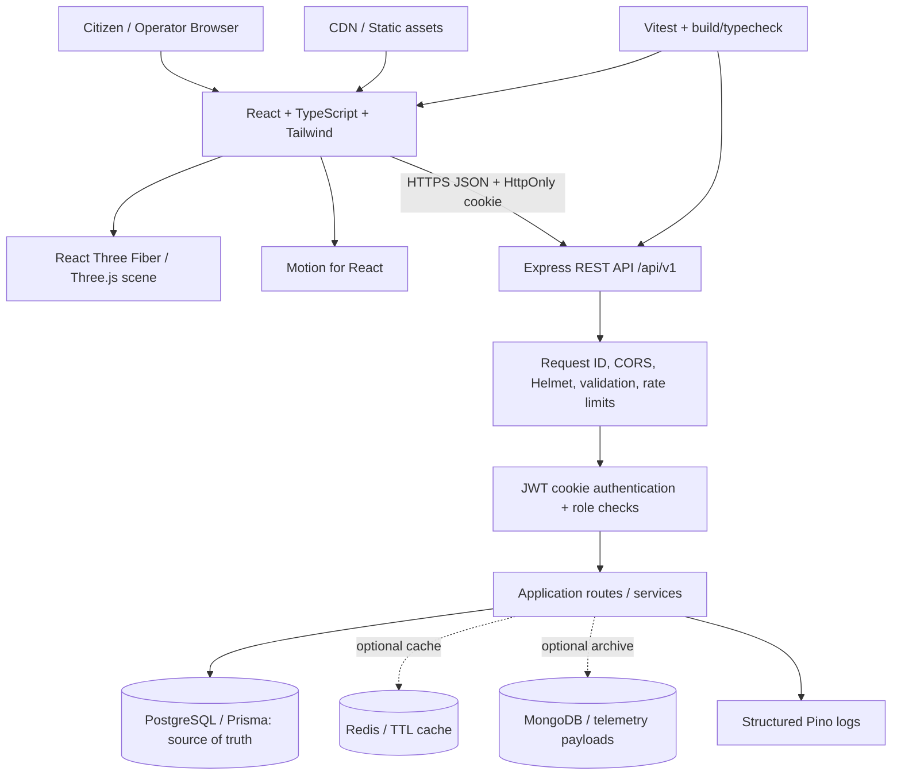

# Terra system architecture

## Boundaries and trust
- The browser is untrusted. Validate every request on the server; derive identity from a verified signed cookie, never a client-supplied user ID.
- The browser calls only `/api/v1`; database URLs and signing secrets exist only in the backend environment.
- PostgreSQL is mandatory and authoritative for users, bins, reports and audit events. Prisma owns SQL access and migrations.
- MongoDB is optional, only for append-oriented sensor/report event payload archives. Archives have a 30-day TTL index and are not authoritative.
- Redis is optional for short-lived bin-list caching (20-second TTL). Cache failure degrades to PostgreSQL reads. Cache invalidation is prefix-based; current invalidation uses Redis `KEYS`, acceptable for a small starter but replace with SCAN or versioned keys at scale.
- MongoDB archive failure is logged and does not roll back committed PostgreSQL business data. A transactional outbox is recommended before telemetry archival becomes compliance-critical.
- Route optimization runs in the API service using a priority-weighted nearest-neighbour heuristic; it is a useful baseline, not a vehicle-routing solver or live-traffic engine.
- Request IDs are accepted only in a bounded safe character set or generated server-side. Pino HTTP logs request lifecycle metadata; errors return a stable envelope without stack traces.

## Authentication
Registration/login issue an eight-hour JWT in an HttpOnly, SameSite=Strict cookie. Production must set `COOKIE_SECURE=true` behind HTTPS and use a strong `SESSION_SECRET`. Mutations reject a supplied disallowed Origin; CORS has a single configured frontend origin. Because deployments may omit Origin on some non-browser clients, network/API access must still be protected at the edge. Consider a synchronizer CSRF token and short-lived access/session rotation before a broader deployment. Role checks guard operator telemetry and report-status mutation.

## Rendering and motion
The hero uses procedural R3F geometry rather than an invented external model path. Its accessible label and all key content remain HTML. Canvas uses capped DPR and low-power preference; `prefers-reduced-motion` reduces object movement and switches the render loop to demand mode. CSS transitions handle small UI interactions; Motion handles page transitions and the report modal. CSS media queries simplify the layout on narrow screens.

## Failure behavior
- PostgreSQL startup failure prevents the API from starting; it is the source of truth.
- Redis/MongoDB connection failures are logged and those optional features are disabled.
- Redis cache misses or errors fall back to the repository query.
- The frontend displays a clearly labeled demo preview when API loading fails; report submission still calls the API and surfaces a connection error rather than pretending success.
- `/health` is liveness; `/ready` checks PostgreSQL and returns 503 when the mandatory dependency is unavailable.
